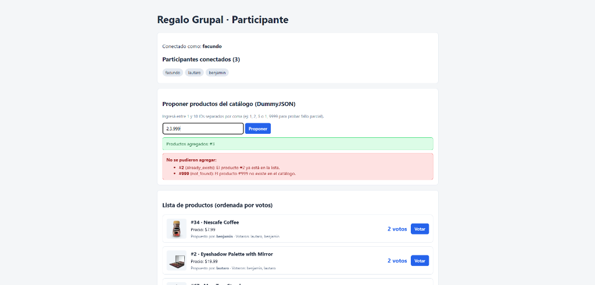
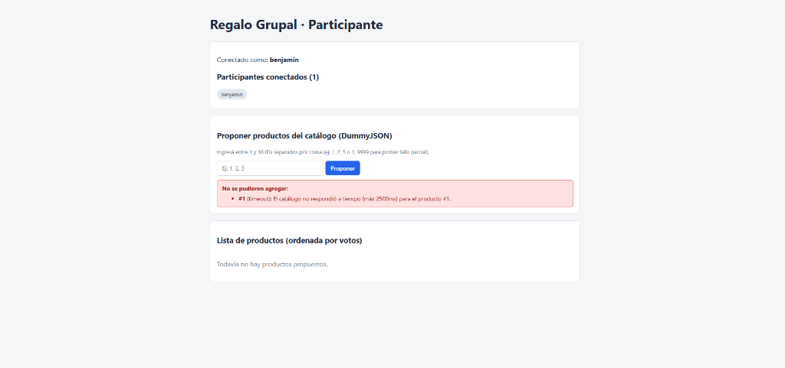
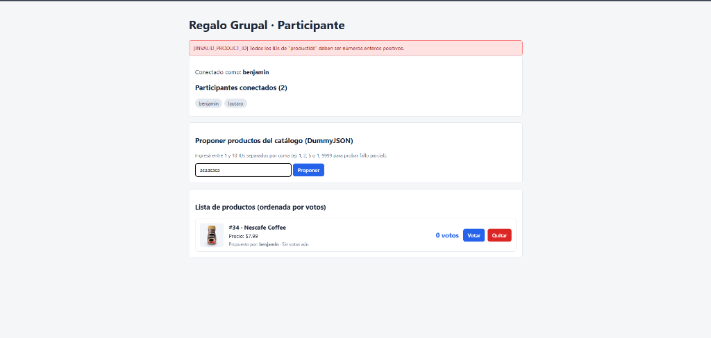

# TP4 · Asincronismo e integración con Node.js y TypeScript

Aplicación web en tiempo real para coordinar la elección de un regalo grupal. Los participantes proponen productos del catálogo externo de **DummyJSON** y votan sus favoritos mediante **WebSockets**, mientras que una pantalla compartida muestra el ranking actualizado en vivo mediante **Server-Sent Events (SSE)**.

---

## 1. Arquitectura y Estructura del Proyecto

Un único servidor HTTP en Node.js con TypeScript (en un solo puerto) sirve las vistas estáticas, gestiona el endpoint de Server-Sent Events (`/events`) y realiza el upgrade de conexiones WebSocket (`/ws`). La lista y los participantes viven en la memoria del servidor mientras está en ejecución.

```text
tp-4-web/
├── public/                 # Frontend estático (HTML, CSS y JS nativo sin frameworks)
│   ├── index.html          # Interfaz del Participante (conexión WebSocket)
│   ├── app.js              # Lógica cliente del Participante
│   ├── screen.html         # Interfaz de la Pantalla compartida (conexión EventSource / SSE)
│   ├── screen.js           # Lógica cliente de la Pantalla
│   └── styles.css          # Estilos compartidos
├── src/                    # Backend (Node.js + TypeScript)
│   ├── index.ts            # Servidor HTTP único (Express + archivos estáticos + SSE + WebSocketServer)
│   ├── config.ts           # Lectura de variables de entorno (puerto, URL del catálogo, timeout, delay)
│   ├── types/
│   │   └── messages.ts     # Contrato de tipos TypeScript para mensajes WebSocket y eventos SSE
│   ├── services/
│   │   ├── catalog.ts      # Cliente asíncrono de DummyJSON con consultas en paralelo y AbortSignal.timeout
│   │   └── state.ts        # Estado en memoria, reglas de negocio y control de concurrencia
│   └── handlers/
│       ├── ws.ts           # Validación estricta de mensajes entrantes y manejo de clientes WebSocket
│       └── sse.ts          # Suscripción y difusión (broadcast) hacia pantallas por Server-Sent Events
├── .env.example            # Plantilla de variables de entorno
├── package.json
└── tsconfig.json
```

---

## 2. Instalación, Configuración y Ejecución

### Requisitos previos
- **Node.js** versión LTS (v20 o superior, que incluye `fetch` y `AbortSignal.timeout` nativos).

### Pasos de instalación
1. Clonar el repositorio e instalar las dependencias:
   ```bash
   npm install
   ```

2. Crear un archivo `.env` en la raíz del proyecto (podés copiar `.env.example`):
   ```env
   PORT=3000
   CATALOG_BASE_URL=https://dummyjson.com/products
   CATALOG_TIMEOUT_MS=2500
   CATALOG_DELAY_MS=0
   ```

3. Iniciar el servidor en modo desarrollo:
   ```bash
   npm run dev
   ```
   O compilar TypeScript a JavaScript y ejecutar en modo producción:
   ```bash
   npm run build
   npm start
   ```

4. Abrir en el navegador:
   - **Participantes (WebSocket):** `http://localhost:3000/` (abrir en varias pestañas para simular múltiples amigos).
   - **Pantalla en vivo (SSE):** `http://localhost:3000/screen.html`

### Configuración y cómo simular un catálogo lento
Todas las opciones del catálogo se configuran por variables de entorno en `.env` **sin modificar el código**:
- `PORT`: Puerto único donde corre el servidor HTTP, WebSocket y SSE (por defecto `3000`).
- `CATALOG_BASE_URL`: URL base del servicio externo (`https://dummyjson.com/products`).
- `CATALOG_TIMEOUT_MS`: Tiempo máximo de espera por cada consulta al catálogo en milisegundos (por defecto `2500`).
- `CATALOG_DELAY_MS`: Milisegundos de demora artificial enviados a DummyJSON mediante el query param `?delay=...` (por defecto `0`).

**Escenarios de prueba con variables de entorno:**
1. **Catálogo lento que responde a tiempo (sin bloquear a otros usuarios):**
   Configurar `CATALOG_TIMEOUT_MS=4000` y `CATALOG_DELAY_MS=2500`. Quien propone verá *"Consultando catálogo..."* durante 2.5 segundos, mientras los demás participantes pueden seguir votando en tiempo real sin bloqueos.
2. **Catálogo que excede el tiempo máximo (corte por timeout):**
   Configurar `CATALOG_TIMEOUT_MS=2500` y `CATALOG_DELAY_MS=4000`. A los 2.5 segundos el servidor aborta la petición y le informa únicamente a quien propuso que el catálogo no respondió a tiempo (`reason: "timeout"`).

---

## 3. Contrato de Mensajes

Todos los mensajes intercambiados son objetos JSON con un campo discriminador `type` y están tipados en [`src/types/messages.ts`](./src/types/messages.ts).

### 3.1. Mensajes Participante $\rightarrow$ Servidor (WebSocket `/ws`)

| Tipo (`type`) | Dirección | Campos y Tipos | Cuándo se envía |
| :--- | :--- | :--- | :--- |
| `join` | Cliente $\rightarrow$ Servidor | `name: string` | Cuando el usuario ingresa su nombre en el formulario inicial para entrar a la lista. |
| `propose` | Cliente $\rightarrow$ Servidor | `productIds: number[]`<br>*(arreglo de 1 a 10 enteros positivos)* | Cuando un participante registrado propone uno o hasta 10 productos del catálogo en una sola acción. |
| `vote` | Cliente $\rightarrow$ Servidor | `productId: number`<br>*(entero positivo)* | Cuando un participante hace clic en **"Votar"** sobre un producto de la lista. |
| `unvote` | Cliente $\rightarrow$ Servidor | `productId: number`<br>*(entero positivo)* | Cuando un participante hace clic en **"Retirar voto"** sobre un producto que ya había votado. |
| `remove` | Cliente $\rightarrow$ Servidor | `productId: number`<br>*(entero positivo)* | Cuando el participante que propuso un producto hace clic en **"Quitar"** para eliminarlo de la lista. |

#### Ejemplos JSON (Cliente $\rightarrow$ Servidor):
```json
{ "type": "join", "name": "Ana" }
{ "type": "propose", "productIds": [1, 2, 99999] }
{ "type": "vote", "productId": 1 }
{ "type": "unvote", "productId": 1 }
{ "type": "remove", "productId": 2 }
```

---

### 3.2. Mensajes Servidor $\rightarrow$ Participante (WebSocket `/ws`)

| Tipo (`type`) | Destinatario | Campos y Tipos | Cuándo se envía |
| :--- | :--- | :--- | :--- |
| `welcome` | **Individual**<br>*(solo quien envió `join`)* | `name: string`<br>`participants: string[]`<br>`products: ProductItem[]` | Inmediatamente después de validar un `join` exitoso, para que quien entra vea el estado completo de la lista y los conectados sin esperar a que ocurra otro cambio. |
| `state_update` | **Broadcast**<br>*(todos los participantes activos)* | `participants: string[]`<br>`products: ProductItem[]` | Cada vez que cambia el estado global: alguien entra o cierra su pestaña, se agregan productos nuevos, alguien vota/retira su voto o se quita un producto. |
| `proposal_result` | **Individual**<br>*(solo quien envió `propose`)* | `added: number[]`<br>`rejected: Array<{ id: number, reason: 'not_found' \| 'timeout' \| 'already_exists' \| 'catalog_error', message: string }>` | Al terminar de consultar en paralelo todos los IDs de una propuesta. Informa qué productos se agregaron y el motivo detallado de cada fallo parcial. |
| `error` | **Individual**<br>*(solo quien envió el mensaje)* | `code: string`<br>`message: string` | Cuando un cliente envía un mensaje inválido (JSON malformado, tipo desconocido, campos faltantes, valores fuera de rango) o intenta realizar una acción no permitida (nombre repetido, votar dos veces, borrar un producto ajeno, actuar sin haber hecho `join`). |

#### Estructura de `ProductItem`:
```json
{
  "id": 1,
  "title": "Essence Mascara Lash Princess",
  "price": 9.99,
  "thumbnail": "https://cdn.dummyjson.com/product-images/beauty/essence-mascara-lash-princess/thumbnail.webp",
  "proposedBy": "Ana",
  "votes": ["Ana", "Beto"]
}
```

#### Ejemplo de `proposal_result` con fallo parcial:
```json
{
  "type": "proposal_result",
  "added": [1, 2],
  "rejected": [
    {
      "id": 99999,
      "reason": "not_found",
      "message": "El producto #99999 no existe en el catálogo."
    }
  ]
}
```

---

### 3.3. Eventos Servidor $\rightarrow$ Pantalla (Server-Sent Events `GET /events`)

La pantalla se suscribe mediante `new EventSource('/events')` y recibe eventos con nombre `state_update`:

| Evento SSE (`event`) | Dirección | Campos del JSON en `data` | Cuándo se envía |
| :--- | :--- | :--- | :--- |
| `state_update` | Servidor $\rightarrow$ Pantalla | `participantCount: number`<br>`participants: string[]`<br>`products: Array<{ id, title, price, thumbnail, proposedBy, voteCount }>` | Al conectarse la pantalla por primera vez y cada vez que se produce cualquier cambio en los participantes conectados o en los productos/votos. |

#### Ejemplo de stream SSE enviado a la pantalla:
```text
event: state_update
data: {"participantCount":2,"participants":["Ana","Beto"],"products":[{"id":1,"title":"Essence Mascara Lash Princess","price":9.99,"thumbnail":"...","proposedBy":"Ana","voteCount":2}]}

```

---

## 4. Decisiones de Diseño y Reglas de Negocio

1. **¿Qué nombres de participantes se aceptan?**
   - Se aplica `.trim()` para limpiar espacios al inicio y al final.
   - **Largo permitido:** entre **2 y 20 caracteres**. No se aceptan nombres vacíos ni de 1 solo carácter (`code: "INVALID_NAME"`).
   - **No se aceptan nombres repetidos entre conectados:** se valida de forma *case-insensitive* (por ejemplo, si `"Ana"` está conectada, nadie puede entrar como `"ana"` ni `"ANA"`, recibiendo `code: "NAME_TAKEN"`). Esto garantiza que sea inequívoco quién propuso cada producto y quién votó. Si el participante cierra su pestaña, su nombre se libera automáticamente.

2. **¿Qué pasa con un producto repetido y cómo se garantiza la consistencia?**
   - **Repetido en el mismo envío:** si un participante envía `[1, 1]`, el primer `1` se procesa y el duplicado se rechaza con `reason: "already_exists"`.
   - **Ya presente en la lista:** si el ID ya existe en la lista compartida antes de consultar a DummyJSON, se rechaza inmediatamente con `reason: "already_exists"` sin realizar una petición HTTP innecesaria.
   - **Propuestas simultáneas (concurrencia):** si dos participantes proponen el mismo ID casi al mismo tiempo mientras la consulta HTTP a DummyJSON está en curso, al resolverse cada promesa el servidor **vuelve a verificar** `this.products.has(id)` antes de insertar. El primero en resolverse inserta el producto y el segundo recibe `reason: "already_exists"`, evitando cualquier duplicado.

3. **¿Quién puede quitar productos de la lista?**
   - **Regla elegida:** únicamente **el participante que lo propuso** (`product.proposedBy === participantName`).
   - En la interfaz, el botón *"Quitar"* solo se muestra al autor de la propuesta. Además, el servidor aplica esta regla estrictamente: si otro participante envía `{"type": "remove", "productId": 1}` desde la consola del navegador, el servidor lo rechaza con un error privado `FORBIDDEN_REMOVE`.

4. **¿Qué tiempo máximo de espera (`CATALOG_TIMEOUT_MS`) se eligió para el catálogo y por qué?**
   - Se eligió **2500 ms (2.5 segundos)** controlado con `AbortSignal.timeout(2500)`.
   - **Justificación:** una API REST pública como DummyJSON responde habitualmente en 150–400 ms. Un límite de 2.5 segundos absorbe picos normales de latencia de red o TLS sin abortar prematuramente, pero evita que el usuario que propuso quede esperando indefinidamente si el servicio externo está caído o colgado. Además, los hasta 10 productos de una propuesta se consultan **en paralelo con `Promise.all`**, por lo que el tiempo total de espera de un lote de 10 productos nunca supera los 2.5 segundos.

---

## 5. ¿Qué ve cada usuario cuando el catálogo falla o tarda?

- **Cuando el catálogo tarda (está lento):**
  - **Quien hizo la propuesta:** ve su botón de envío deshabilitado con la leyenda `"Consultando catálogo..."` hasta que el servidor responde.
  - **Los demás participantes y la pantalla:** **no experimentan ningún bloqueo**. Pueden seguir votando, retirando votos, proponiendo otros productos o entrando/saliendo con total normalidad e instantaneidad.
- **Cuando el catálogo falla (fallo total o parcial en un lote):**
  - Si un participante propone varios IDs (ej. `1, 2, 99999`), los productos que sí respondieron bien (`1` y `2`) se agregan de inmediato a la lista de todos los participantes y de la pantalla.
  - **Solo quien hizo la propuesta** ve una alerta detallando qué IDs fallaron y la causa específica de cada uno:
    - `not_found`: el ID no existe en DummyJSON (HTTP 404).
    - `timeout`: el catálogo tardó más que `CATALOG_TIMEOUT_MS`.
    - `already_exists`: el producto ya estaba en la lista.
    - `catalog_error`: error de red o HTTP 5xx del catálogo.
  - **Los demás participantes y la pantalla** no reciben ningún mensaje de error ajeno; solo ven aparecer los productos válidos agregados.

---

## 6. Justificación Técnica: WebSocket vs. Server-Sent Events (SSE) vs. Polling

### ¿Por qué los participantes usan WebSocket y la pantalla usa SSE?
- **Participantes $\rightarrow$ WebSocket:**
  Los participantes requieren comunicación **bidireccional (full-duplex)** de baja latencia. No solo reciben actualizaciones del ranking en vivo, sino que envían constantemente comandos al servidor (`join`, `propose`, `vote`, `unvote`, `remove`) y reciben respuestas individuales (`welcome`, `proposal_result`, `error`). WebSocket mantiene una única conexión TCP abierta por participante, evitando la sobrecarga de abrir peticiones HTTP por cada acción y permitiendo detectar al instante cuando alguien cierra la pestaña (`close`).
- **Pantalla $\rightarrow$ Server-Sent Events (SSE):**
  La pantalla (televisor o proyector) es un cliente **exclusivamente receptor (unidireccional Servidor $\rightarrow$ Cliente)**: solo muestra el ranking y la cantidad de participantes conectados, y jamás envía datos al servidor. Para este caso, SSE (`EventSource`) es la herramienta ideal: funciona sobre una conexión HTTP tradicional (`text/event-stream`), es más simple que WebSocket cuando no hay mensajes de subida y el navegador gestiona la reconexión automática de manera nativa si se corta momentáneamente la red.

### ¿Qué cambiaría si la pantalla usara Polling?
Si en lugar de SSE la pantalla hiciera *short polling* (por ejemplo, un `fetch('/api/state')` cada 2 o 3 segundos con `setInterval`):
1. **Pérdida de tiempo real (mayor latencia):** los votos y cambios en los participantes no se verían al instante, sino con un retraso de hasta $N$ segundos según el intervalo configurado.
2. **Tráfico y carga innecesaria en el servidor:** incluso cuando ningún participante está votando ni proponiendo nada, la pantalla enviaría decenas de peticiones HTTP por minuto (con todos sus headers HTTP) solo para recibir exactamente el mismo JSON sin cambios. Con SSE, en cambio, la conexión permanece abierta en reposo y el servidor **solo envía datos cuando realmente ocurre una modificación** en la lista.

---

## 7. Evidencia de Funcionamiento

Toda la evidencia solicitada se encuentra en la carpeta [`./evidencia`](./evidencia):

### 7.1. Video con 3 participantes y la pantalla sincronizados en tiempo real
- **Archivo de video:** [`evidencia/sincronizacion-3-participantes-y-pantalla.webm`](./evidencia/sincronizacion-3-participantes-y-pantalla.webm)

<video src="./evidencia/sincronizacion-3-participantes-y-pantalla.webm" controls width="100%"></video>

### 7.2. Propuesta con fallos parciales (`already_exists`, `not_found` y producto válido agregado)
Cuando un participante propone `2, 3, 999` en una sola acción: el producto `#3` se agrega a la lista de todos, mientras que únicamente quien propuso recibe los motivos de rechazo para `#2` (`already_exists`) y `#999` (`not_found`).



*(También se incluyen capturas individuales de producto inexistente en [`evidencia/producto-inexistente.png`](./evidencia/producto-inexistente.png) y producto repetido en [`evidencia/producto-repetido.png`](./evidencia/producto-repetido.png)).*

### 7.3. Comportamiento con el catálogo lento (`timeout`)
Simulando una demora del catálogo superior al tiempo máximo de espera configurado (`CATALOG_TIMEOUT_MS=2500`), el servidor aborta la petición sin bloquear a los demás usuarios e informa a quien propuso el motivo `timeout`:



### 7.4. Respuesta a un mensaje inválido
Al enviar un mensaje con valores o formato inválido, el servidor valida la entrada, responde con un mensaje de error (`INVALID_PRODUCT_ID`) únicamente al emisor y continúa funcionando sin caerse:


